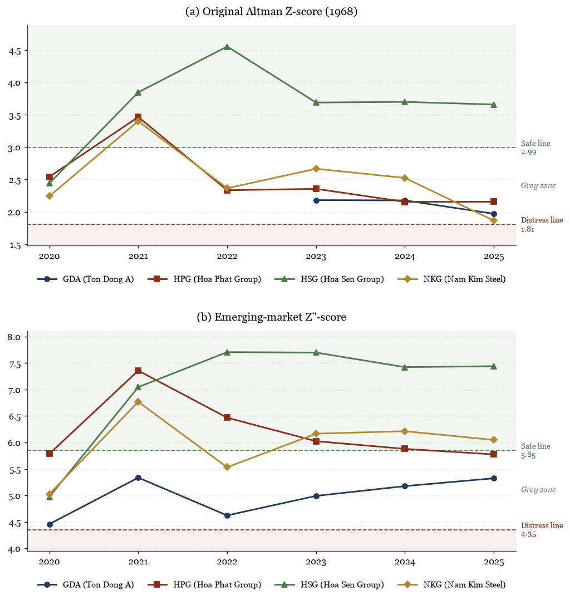

# Financial Health of Vietnamese Steel Producers, 2021–2025

**Author:** Hoang Duc Binh · November 2026

📄 **[Read the full report (PDF)](vietnam_steel_report.pdf)**

A peer comparison of four listed Vietnamese steel producers through the 2021 steel boom and the 2022–2023 downturn. It uses audited consolidated financial statements for 2020–2025, ratio analysis, the Altman Z-score (original and emerging-market versions) and the Piotroski F-score.

| Ticker | Company | Business model | Financial year end |
|---|---|---|---|
| HPG | Hoa Phat Group | Integrated steelmaker (blast furnaces) | 31 December |
| HSG | Hoa Sen Group | Coated steel | 30 September |
| NKG | Nam Kim Steel | Coated steel | 31 December |
| GDA | Ton Dong A | Coated steel | 31 December |

## Research question

How did these four companies come through the 2021 steel boom and the 2022–2023 downturn, and which of them is financially strongest going into 2026?

## Key findings

- **Boom and bust:** all four earned a return on equity of 35–40% in 2021. In 2022, Nam Kim and Ton Dong A made losses and could not cover their interest expense from operating profit.
- **Strongest balance sheet: Hoa Sen.** It has the lowest debt (debt to equity 0.39, no long-term borrowings) and the highest Altman scores, after cutting inventory and repaying debt during the downturn.
- **Most profitable: Hoa Phat.** It has a 10% net margin against 1–2% for the coated-steel makers, thanks to its integrated model. Heavy capital spending has made its free cash flow strongly negative.
- **Most vulnerable: Ton Dong A.** It has the highest leverage (debt to equity 1.59), thin interest cover and falling revenue.
- **On the models:** no company entered the distress zone of either Altman model. The original Z-score penalises capital-intensive producers through its sales-to-assets term, so the emerging-market Z''-score fits Vietnamese steel firms better.



### Scorecard, 2025

| Measure | GDA | HPG | HSG | NKG |
|---|---:|---:|---:|---:|
| Revenue growth | −20.0% | 12.4% | −7.0% | −28.1% |
| Gross margin | 6.5% | 15.7% | 12.4% | 5.3% |
| Return on equity | 6.9% | 11.8% | 6.5% | 2.6% |
| Debt to equity | 1.59 | 0.70 | 0.39 | 0.90 |
| Interest coverage | 2.30 | 6.79 | 5.46 | 2.10 |
| Altman Z'' (emerging markets) | 5.32 (grey) | 5.77 (grey) | 7.44 (safe) | 6.05 (safe) |
| Piotroski F-score | 4 | 6 | 5 | 4 |

## Method

- **Ratios:** profitability, liquidity, solvency and efficiency, with EBIT = profit before tax + interest expense.
- **Altman Z (original, 1968):** 1.2·X1 + 1.4·X2 + 3.3·X3 + 0.6·X4 + 1.0·X5. Safe above 2.99, distress below 1.81.
- **Altman Z'' (emerging markets):** 3.25 + 6.56·X1 + 3.26·X2 + 6.72·X3 + 1.05·X4 (book equity). Safe above 5.85, distress below 4.35.
- **Piotroski F-score:** nine yes-or-no signals (ROA > 0, CFO > 0, higher ROA, CFO > net income, lower long-term leverage, higher current ratio, no new shares, higher gross margin and higher asset turnover). Year-end assets are used instead of averages.

Every formula is written out in plain pandas in [`steel_analysis.py`](steel_analysis.py) so it can be read and checked.

## Repository contents

| File | What it is |
|---|---|
| [`vietnam_steel_report.pdf`](vietnam_steel_report.pdf) | The full report |
| [`analysis.ipynb`](analysis.ipynb) | The analysis notebook: code, charts, tables and interpretation |
| [`steel_analysis.py`](steel_analysis.py) | All formulas: ratios, Altman Z-scores and the Piotroski F-score |
| [`data/steel_financials.csv`](data/steel_financials.csv) | Input data, hand-collected from the audited statements (billion VND) |
| [`data/SOURCES.md`](data/SOURCES.md) | Where every figure comes from, with the statement line items used |
| [`build_report.py`](build_report.py) | Rebuilds the HTML and PDF report from the notebook |

## How to reproduce

Requires Python 3.11 or newer.

```bash
pip install -r requirements.txt
python build_report.py
```

This runs the notebook and writes `vietnam_steel_report.html` and `vietnam_steel_report.pdf` (the PDF step uses Microsoft Edge). To explore the analysis interactively, run `jupyter notebook analysis.ipynb`.

## Data

All financial figures are from each company's audited consolidated financial statements under Vietnamese Accounting Standards, published on its investor-relations website. Share prices are year-end closing prices from CafeF and Vietstock. The original report PDFs are not included in this repository; [`data/SOURCES.md`](data/SOURCES.md) lists which report each year comes from.

## Limitations

The scoring models were built on US data, the sample is small (four companies), Hoa Sen's financial year ends in September, and the analysis uses financial statements only. The full list is in section 9 of the report.
